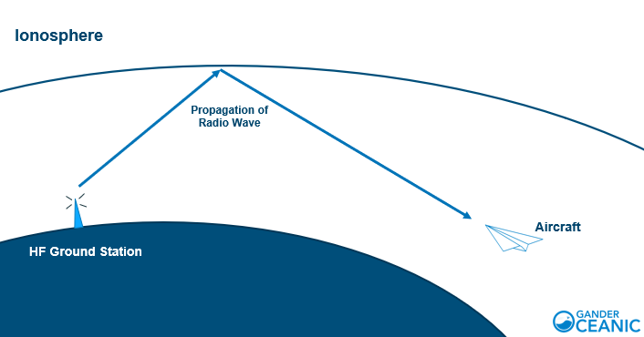
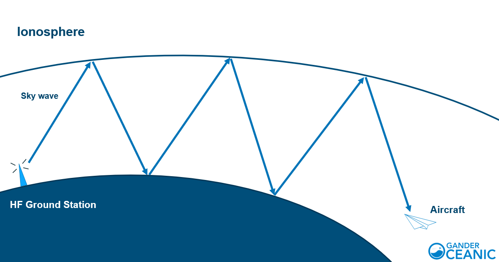

<!--
title: High-Frequency Radio
description: All the static and buzz that comes with Oceanic communication.
published: true
date: 2021-07-31T11:29:16.614Z
tags: 
editor: undefined
dateCreated: 2020-09-11T03:43:25.793Z
-->

# Communication over High Frequency

## What is High-Frequency Radio?

Let's talk about communication. Most VATSIM pilots are used to the "Clear, Crisp, Ultra HD" communication over the Very High Frequency (VHF) radio used in most domestic ATC zones, and is the primary technology used to facilitate Air-Ground-Air (AGA) communication.

Whilst the clarity and reliability of VHF transmissions makes them ideal for AGA communication use, the technology's reliance on ‘line-of-sight’ (just like radar) makes it virtually impossible to communicate with aircraft beyond 250-280 NM. This isn't nearly enough range to cover the entire ocean. Even if it was decided to station remote ships fitted with VHF receivers in the middle of the ocean, the cost and lack of efficiency would grossly outweigh the benefit.

For most populated areas around the world, where it is possible to install numerous radio transceivers on land, this limitation is not a factor. However, over the oceans and throughout very remote areas of the world, building a network of VHF transceivers is very difficult, if not impossible. An alternative solution is therefore required.

The answer is found through the use of High Frequency (HF) radio. In the real world, CPDLC is now the primary means of communicating with oceanic ATC and voice is the alternative, but HF remains the dependable fallback that every crew must be able to use, which is why a SELCAL or HF watch is still required. On VATSIM, voice is still the main way pilots talk to oceanic controllers.

Even if you plan to use CPDLC, you still need to <strong>check in with Oceanic ATC first</strong> by voice (a SELCAL check is part of that call). Once the controller has identified you, you can then log on to CPDLC (see <a href="/pilots/cpdlc/">Hoppie's Usage</a>) and use it as your primary means of communication. Keep your HF or SELCAL watch while you are in oceanic airspace.

### HF on VATSIM

HF is simulated on VATSIM, but many aircraft cannot tune an HF radio. So that everyone can take part, each oceanic position also has a <strong>VHF alias frequency</strong>. You tune the VHF alias on your COM radio, and the audio software treats it as the controller's HF frequency. The HF frequency for each position is shown in the controller's frequency list, and you can also ask the controller.

If your software supports it, you can also add the HF frequency by the controller's callsign. TrackAudio, for example, supports HF for stations that are already defined in the audio network's database, and applies HF squelch by default. Check your own software's documentation for how it handles HF.

On VATSIM, HF sounds much like VHF with extra static, and the further you are from the station, the worse it gets. The static is the main difference, but it can make communication difficult at times, so use the tips at the end of this page.

## Propagation of High-Frequency Radio Waves

HF utilises a lower frequency band (3 MHz to 30 MHz) than VHF. Frequencies in this band have longer wavelengths than those in the VHF band. As a result, instead of continuing in a straight line, through the atmosphere and into space, the waves can be reflected by the Earth’s atmosphere, allowing for ‘over the horizon’ communication. This allows communication via HF to be effective over extremely long ranges, as far as 8,000 NM or even further under ideal conditions.

<figure class="image image_resized" style="width:55.93%;">
  <figcaption>Transmissions over HF are able to ‘skip’ across the ionosphere, enabling ‘over the horizon’ communication.</figcaption>
</figure>

HF radio waves can propagate as 'ground waves' or ‘sky waves’. Ground waves are received over shorter distances closer to the transmitter.&nbsp;

Sky waves, on the other hand, can travel far greater distances. At the longer wavelengths used in HF communication, the waves can interact with the ionosphere, an electrically-charged layer of the Earth’s atmosphere. The waves bounce directly off the ionosphere and back towards the ground. The signal is often reflected multiple times, ‘skipping’ between the surface of the Earth and the ionosphere, and as a result, the waves can propagate many thousands of miles. An analogy to understand this is the idea of skipping a stone across water, at the right angle, the stone bounces off the surface of the water and back into the air, often several times.

The maximum range for HF radio waves is heavily dependent upon atmospheric conditions, the angle at which the signal meets the ionosphere and the frequency of the radio wave. For example, at night, the ionosphere is generally lower than during the day. This means that the angle at which the radio waves make contact with it is shallower and therefore they can skip further.

<figure class="image image_resized" style="width:54.88%;">
  <figcaption>Sky waves can skip several times to cover extremely large distances.</figcaption>
</figure>

The frequency of the radio wave also plays an important role. As a general rule of thumb, higher frequencies (10-30 MHz) work better during the day, and lower frequencies (2-10 MHz) work better at night.

## The Incessant Static

Naturally with the nature of HF radio propagation, there is a propensity to pick up a level of atmospheric interference. The more bounces the wave performs, the more interference that can occur. This is why HF can be very noisy.

<figure class="image image_resized" style="width:28.22%;"></figure>

## The Future of Oceanic Communication

In recent years, HF has been put under the spotlight. Whilst HF is very reliable, it is noisy, as mentioned, and alternatives to the technology have been explored.

One of these solutions has been CPDLC (Controller-Pilot Data Link Communication). Using CPDLC, a pilot can compose text messages and communicate with the controller without using the radio. CPDLC has become a very viable solution in many areas of the world as an alternative to voice communication in non-urgent situations.

ADS-B/ADS-C is another solution that has largely superseded the need for voice position reporting. Currently, a combination of ADS-C and Space-Based ADS-B is used to provide regular, real-time aircraft position updates as well as event-based updates (e.g. aircraft is climbing; aircraft is leaving designated route). Because of this, on the VATSIM network, aircraft that do have an ADS-B or ADS-C equipment are not required to provide position reports, however, they are more than welcome to do so if the controller workload permits them to do so!

## Tips for using High-Frequency Radio

Most of the time, you will be communicating with the controllers via the radio, but as mentioned, communicating with the controllers can be a bit tricky.&nbsp;

Here are some tips to help you out.&nbsp;

<ul>
  <li>Speak slowly on the frequency - both the controller and yourself hear the same transmission quality and speaking at a lower rate ensures that the controller has the best chance of understanding you. Sometimes the controller will need to write down elements of your transmission and a slower transmission assists them greatly</li>
  <li>Depress your Push-To-Talk (PTT) button fully before speaking, however, do not depress your PTT until you are ready to speak</li>
  <li>Avoid turning your head away from the microphone, and aim to keep the distance between your mouth and the microphone the same whilst speaking</li>
  <li>Use a normal conversation volume; there is no need to speak any louder</li>
  <li>Speak clearly and evenly</li>
  <li>A slight pause before and after any numbers will make them easier to understand</li>
  <li>Avoid including unnecessary words or phrases in your message (as well as hesitations such as “err”, “uhh”, etc.); the more concise the transmission, the better. A good rule of thumb is: if the transmission still conveys your message after you leave a particular word out, then the word should not be in the transmission</li>
  <li>Avoid excessive use of courtesies, and avoid entering into non-operational conversations over the radio</li>
  <li>Keep in mind that the controller's native language may not be English – speak clearly and use standard radiotelephony (RTF) words and phrases wherever possible</li>
  <li>Messages should not contain more than three specific phrases, comprising a clearance, instruction, and any pertinent information. In many cases, the controller may pass each phrase separately to reduce the possibility of a misunderstanding</li>
  <li>Do not release the PTT button until after you have completely finished speaking to avoid ‘clipping’ the end of your transmission</li>
  <li>When transmitting a message, it is a good idea to say your callsign twice and wait for the controller to respond before passing your full request. This ensures the controller is ready to receive your transmission and knows exactly where it is coming from</li>
  <li>Most importantly of them all! Wait for the frequency to fall silent before transmitting otherwise you may block someone else's important transmission</li>
</ul>

## Sources

Audio for VATSIM Documentation https://www.skybrary.aero/index.php/Automatic_Dependent_Surveillance_(ADS) NAT Document 007

