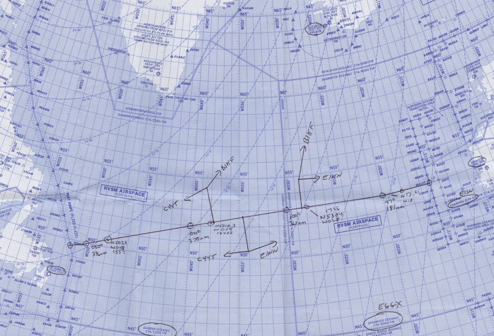

<!--
title: Flight Planning over the North Atlantic
description: Routes, levels, and other cool stuff.
published: true
date: 2021-09-23T12:34:43.097Z
tags: 
editor: undefined
dateCreated: 2020-09-11T03:39:21.105Z
-->

# Planning your Flight

Oceanic flight planning can be a handful. With so many nuances and procedures that are different from domestic flight, it is easy to feel overwhelmed. However, with enough practice, it is an immensely gratifying skill and a tool that you can add to your VATSIM arsenal.

In this article, we will outline the basics of oceanic flight planning and some tips and tricks you can take advantage of to perform a successful oceanic flight.

<figure class="image image_resized" style="width:60.79%;"></figure>
<h2>Routes</h2>

In the previous article (see <a href="/pilots/basics/nats/">NAT Tracks</a>) we discussed the two main types of oceanic routing, NAT Track and Random Routing. However, which one do you choose?

As discussed, eastbound and westbound flight on the OTS are only available at certain times of the day. Much of the time, it will be possible to utilise a NAT track, and if this is the case, then it should be the preferred option, however, there are many situations where a published track is simply not available for a pilot's direction of flight and/or requirements. Therefore, a Random Routing is required. Many flight planning tools such as SimBrief generate a suitable Random Routing, however, at times, it may be necessary to make one up. In that case, observe the high-level weather forecast and plot a logical route, for example, select a waypoint every 10 degrees of longitude.

## Flight Levels

Each NAT track has a set of flight levels published in the NAT track message (see the example on the <a href="/pilots/basics/nats/">NAT Tracks</a> page), so altitude choice is straightforward on a track. The levels differ from track to track and from day to day, so always check the current message.

<strong>Random Routings:</strong> older editions of NAT Doc 007 carried a Flight Level Allocation Scheme (FLAS), which pushed random-route traffic onto different levels depending on direction and time of day. That attachment has been removed from the current edition (V.2026-1, in force from 19 March 2026) and nothing has replaced it. A random-route flight may now plan any level, provided it works with the traffic flows and ATC can accommodate it. Ask for the level you want, and tell the controller the highest level you can accept.

## Mach Number

Instead of Indicated Airspeed (IAS), Mach is used in oceanic airspace. Mach is very important for aircraft operating at high levels at high speed, as it is a better representation of the aircraft's actual speed through the air than ground speed or IAS at cruising levels. Pilots may file their preferred Mach number and in most cases will receive a clearance with that Mach number. It is rare for a controller to assign anything more than .02 Mach below or .01 Mach above the requested speed.

<figure class="image image_resized" style="width:56.83%;">
  <figcaption>Speed in oceanic airspace is measured in “Mach”, which ratio between the aircraft's true airspeed (TAS) and the speed of sound.</figcaption>
</figure>

## Other General Tips
<ul>
  <li>If you don't understand what the controller said, say so! They will explain it to you in a different way. Likewise, if you cannot do something, tell them that you are ‘unable’ and they can find an alternative.</li>
  <li>If you are not sure about any aspect of your oceanic flight, don't be afraid to private message the oceanic controller. More often than not, they will be more than happy to help you out.</li>
  <li>If you need something from the controller, for example, a change of flight level or a change of speed, just ask! In many cases, the controller can accommodate the request.</li>
  <li>For information regarding appropriate phraseology, please view our phraseology guides for <a href="/pilots/atc/clearances/">clearances</a>, <a href="/pilots/atc/pos-reps/">position reports</a> and <a href="/pilots/atc/revisions/">amendments</a>.</li>
</ul>

## Sources

NAT Document 007

